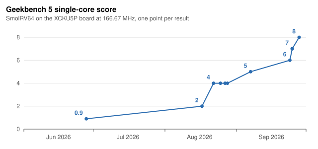
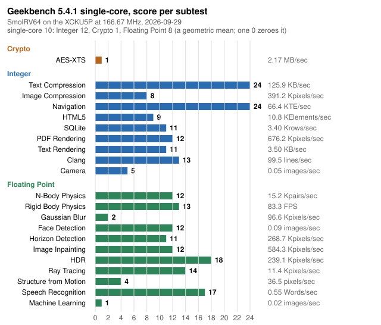

# SmolRV64



SmolRV64 is a 64-bit RISC-V application processor, written from scratch in Verilog, that
boots stock Ubuntu on a Kintex UltraScale+ FPGA at 166.67 MHz and runs Geekbench on it.
It is a four-wide out-of-order machine with register renaming, a decoupled fetch stream
over a virtually tagged 128 KiB instruction cache, a scheduler per lane, a load queue and a senior
store queue, non-blocking tagged loads into a non-blocking 128 KiB data cache, a tagged
four-deep FPU pipeline, a 2 MiB second-level cache in UltraRAM, and coherent DMA: every
device's line is cleaned or flushed in the caches before it moves. Every committed
instruction is checked in lockstep against an independent ISA model, and every non-trivial
change has to boot Ubuntu to a login prompt on the board with zero faults before it lands.



| | |
|---|---|
| Geekbench 5.4.1, board, 2026-10-29 | **20** single-core (Integer 24, Crypto 2, Floating Point 13), **20** multi-core ([result 24766670](https://browser.geekbench.com/v5/cpu/24766670), [every subtest](workloads/gb5/result-2026-10-29.md)); the whole suite in 1 h 36 min at IPC 1.34 |
| Memory, board, 2026-10-29 | a dependent load **3.0** cycles from the D$, **21.0** from the L2, 45.1 from DRAM with a second-level dTLB lookup (71.0 with a page walk); sequential reads 7.93 bytes a cycle in the D$, 3.71 from the L2, 2.88 from DRAM, writes 7.91, 5.64 and 5.17 (`tools/board/membench/summary.sh`, beside every Geekbench run) |
| Geekbench 6.7.1, board (4 GiB), 2026-10-15 to 16 | **10** single-core, **10** multi-core ([result 19352041](https://browser.geekbench.com/v6/cpu/19352041), [every subtest](workloads/gb6/result-2026-10-16.md)); the whole suite in 17 h 48 min at IPC 1.00 |
| Dhrystone 2.1, the RTL in lockstep simulation, 2026-10-29 | **3.07** DMIPS/MHz: 185.2 cycles a run, DMIPS being runs a second over 1757 (riscv-tests' Dhrystone at `-O2` with the full `-march`; `make run B=dhrystone` in [workloads/rvbench](workloads/rvbench)) |
| CoreMark 1.0, the RTL in lockstep simulation, 2026-10-29 | **5.52** CoreMark/MHz: 181,084 cycles an iteration, the standard 2K performance run's CRCs (`-O2` with the full `-march`; `make run B=coremark`) |
| `sha256sum` of a 30 MB file, board, 2026-09-25 | IPC 1.56 to 1.63 over three runs, 43 cycles per byte |
| Clock | 166.67 MHz on the XCKU5P (a 6.000 ns cycle), closed four-wide; DDR4 at 333 MHz |
| Software | OpenSBI and mainline Linux; Ubuntu 25.04 boots over an NFS root through the core's own virtio-net |

**Why three bars are so short.** Gaussian Blur, Structure from Motion and Machine Learning
score 2, 4 and 1. They are SIMD-shaped kernels: Machine Learning executes about six billion
scalar instructions per image, where Geekbench's reference machine uses SIMD, and this core has
no vector extension. Its hot loop, a naive SGEMM, walks a column of a matrix at a 2048- or
4096-byte stride, which puts every element of a column in one set of the data cache, whose 32
ways hold 32 of them; the 2048-entry dTLB keeps the walk out of the page walker. A vector unit is the larger lever on all three,
and whether one fits without giving up the clock is an open question below.

## Why it is interesting

**A real out-of-order core sized for an FPGA.** SmolRV64 is what an R10000-style machine
looks like when every structure is chosen by what a Kintex LUT, LUTRAM or block RAM does well
([the specification](docs/SmolRV64-Spec.md) is the normative description, and every number below
is read off the RTL or measured with the workload named):

- **Four-wide dispatch and retire behind a decoupled fetch stream.** The fetch stream reads a
  16-byte window from any halfword per cycle from the instruction cache into a 32-halfword
  fetch ring, so code runs at full width whatever its alignment, ahead of decode, whose
  instruction boundaries are found as the bytes arrive; up to six RVC or 32-bit instructions
  a cycle go from it into a 16-entry decoupling queue; up to four are renamed and dispatched
  a cycle, consecutive instructions to consecutive lanes (the lanes rotate, so each takes
  every fourth with no steering), and up to four retire.
- **A status-only reorder buffer.** 64 rows of four, of which 228 entries are live at once
  (the 9-bit sequence number that orders restarts bounds the window), 25 bits each: the
  destination and its new and previous mappings -- no values, no PCs, no operands. A second,
  *irrevocable* pointer walks ahead of the head over completed entries and commits stores
  early, so a store never holds retirement for the cache's write. A mispredict recovers from
  its resolve: a walk from the tail back to the branch restores each dead entry's previous
  mapping and returns its register, and a kill by age drops the dead ops everywhere at once
  while fetch restarts; a branch that reaches the head first squashes there.
- **A physical register file sharded by writer.** Six shards of 64 registers, one write port
  each: one per lane, written by that lane's write register alone (its ALU and multiply
  results, and every load, divide, CSR and FP integer result it lands), and two for FP (the FP
  loads', the FP stage's). Duplication buys read ports, nine per integer shard; sharding by
  writer is what buys write ports.
- **A scheduler per lane, no age matrix.** Four integer schedulers of ten entries, one per lane,
  and an eight-entry FP scheduler behind an eight-entry FIFO. Each selects by fixed priority
  with wake-at-select, so a dependent issues the cycle after its producer, and an op's operand
  bypass is its scheduler's registered wake match, so the execute cycle compares no tag. An
  address generator may issue on a load's data-cache lookup before it answers: a load's result
  used as an address is three cycles away, any other use four. Entries hold only physical
  register tags and ready bits; the execute payload sits in a separate LUTRAM indexed by
  scheduler entry, never by ROB slot.
- **Rename with a map copy per lane.** A speculative map in one copy per rename slot (a register
  names the copy that holds its newest mapping) and a committed map, per-shard free lists with a
  speculative and a committed head; the walk restores the map after a mispredict, and after a
  squash at the head a sweep rewrites the registers renamed since from the committed map.
- **Loads that leave the pipeline.** Loads and stores generate their address in their lane and
  reach memory through a 16-entry load queue and a 32-entry store queue; stage M takes them in
  the order their addresses arrive and starts a load's access in the same cycle when no older
  store is in its way. A store that holds every byte of a younger load forwards them; a load
  may go ahead of older stores whose addresses are unknown unless a 256-entry table of 2-bit
  counters says it has collided before. Up to 16 loads are in flight to the data cache at once,
  matched by the load-queue tag they carry. The store queue is senior to retirement: a
  committed store's ROB slot retires while its bytes drain behind it, and a redirect flushes
  only the uncommitted tail.
- **System operations at the head, from flops.** CSR accesses, fences and the traps decided
  at dispatch (illegal instructions, fetch faults) wait in a one-entry system queue and fire
  when they reach the ROB head, from registers, so none of them sits in the memory stage's
  completion path; the memory stage holds only loads, stores, AMOs and cache operations.
  Each lane multiplies in three cycles; divides run in their own stage and land by tag.
- **A tagged, four-deep FPU.** CVFPU (fpnew) with four operations in flight, results
  returned by tag and out of order, and its own scheduler and execute stage, so FP
  arithmetic never enters the memory stage and cannot block it; FP operations issue out of
  order among themselves.
- **Prediction at the fetch stream.** Two BTBs, each eight halfword banks of two skewed ways
  and taken-only (a branch is allocated when it resolves taken): a 1024-entry L1 in
  distributed RAM, read in the predictor's one-cycle loop, and an 8192-entry L2 in block RAM
  a cycle behind it, which checks every window and, when the two disagree, fills L1 and
  restarts the stream at that window. With a 2048-entry YAGS corrector in eight
  distributed-RAM banks, an 11-bit path history carried with each instruction, and an 8-entry
  return stack they predict each 16-byte window as it is fetched, keyed by a control-transfer
  instruction's last halfword; an 8-entry prediction queue carries each prediction's state to
  the instruction it names, and a 32-entry training queue trains each one once it can no
  longer be squashed. No table has a valid bit: validity is the tag match.
- **Caches built from what the part has.** A 128 KiB two-way instruction cache that is
  virtually indexed and hits on its virtual tag and an epoch, reconciling by physical tag
  only on a miss, so a hit needs no translation; it reads a 16-byte window from any halfword
  every cycle (each way's lines in an even and an odd 16-byte bank, the next line's tags
  through the tag RAM's second port), stores probe it, so `fence.i` keeps it unless a device
  has written memory since. A 128 KiB, 32-way write-back data cache, its
  set inside the page offset so no line can have a synonym, that never blocks on a miss: two
  lookups a cycle, one for a load, answered by tag two cycles later, and one for a committed
  store, which writes its bytes into the one block RAM that holds them or merges them into its
  line's fill; a store queue that takes a store every cycle; eight miss registers whose merge
  buffers let loads and stores join a line in flight; hits under misses; two write-back lines;
  and a waiter table that replays each blocked requester, round robin, when what it waits on
  frees. A not-recently-used bit per line picks the way to fill. Its data lies diagonally over
  32 block RAMs, so a load reads one 64-bit word of each and a dirty line comes out whole in
  one cycle. Page-table walks read through the data cache, so a walk always sees dirty
  page-table entries.
- **A 2 MiB L2 in the core's clock.** All 64 of the part's UltraRAMs, 8 ways of 4096 sets,
  between both caches and DRAM: a load that misses the data cache and hits the L2 takes 21
  cycles where DRAM takes 34. Misses do not block it (eight in flight, their lines passed up
  beat by beat as they arrive), write-backs land in it, and a DMA master's line is cleaned or
  flushed in it after the data cache.
- **Virtual memory as Linux expects it.** Sv39 with hardware page-table walkers, a
  64-entry dTLB and iTLB, each backed by a second level (2048 and 512 entries: 8 MiB and 2 MiB
  of reach), superpages, Ssvnapot leaves, Svpbmt non-cacheable mappings plus Zicbom
  and Zicboz cache-management operations. Misaligned loads and stores are handled in hardware,
  including across cache lines. Every physical address the core holds is 33 bits, the
  top of its 4 GiB DRAM window, and wider for a larger one: the MMUs range-check every resolved
  physical address and fault rather than drop the access.
- **Interrupts through the trap path.** An external or timer interrupt is injected as a
  pseudo-op that traps in stage M, so traps, faults and interrupts share one precise
  mechanism; a pending interrupt waits out a page-straddling fetch rather than abandoning
  it.

**An SoC that runs the real thing.** CLINT, PLIC, an NS16550A UART hardwired to 3 Mbaud with a 4 KiB receive FIFO,
virtio-blk backed by an SD card over SPI, virtio-net over RGMII with an eight-slot receive
ring and word-wide DMA, a virtio keyboard and mouse fed by USB devices through a Pico (see
[Virtio devices](#virtio-devices)), a 256 KiB boot SRAM holding a ROM monitor that boots over TFTP or from the
SD card or takes an XMODEM upload and has a memory-integrity command set and a DRAM test, the L2, and one 512-bit line port into DDR4 (2 GiB, or 4 GiB on a board with 16 Gb
parts) with a hardware latency monitor on it, through our own DDR4 controller on the DDR4 IP's physical layer. Ubuntu boots to `login:` over an NFS root; the board has run for days at a
time.

**Verification that is part of the design.**

- **Lockstep cosimulation against [Simmerv](https://github.com/tommythorn/simmerv).** A DPI
  bridge hands every retiring instruction to the ISA model and compares PC, destination,
  value, privilege, traps and memory effects. It runs the tiny128 Linux boot (300 million
  cycles is the required length), the Geekbench image's kernel boot (over 400 million),
  a glibc userspace harness (ld.so, dash, coreutils, four iterations of a checksum), and
  systemd's own loader through 20 shared libraries, because the small boot never runs that
  code.
- **206 always-on invariants.** Every "this cannot happen" in the RTL is a `$fatal`, never
  an `ifdef`: tagged responses matched to their requester, a load never starting while the
  live alias check holds it, the scheduler's payload compared against the pipeline every
  cycle, the two ROB pointers never crossing, nothing that changes memory started off the
  ROB head. Detection latency, not defect rate, is what costs days.
- **The same invariants on the board.** An integrity log latches the caches', the LSU's and
  the frontend's invariants into sticky hardware bits, with the first one's cycle; Linux
  reads it back after every board run, and a nonzero log fails the gate however clean the
  console looked.
- **Random programs in lockstep.** `workloads/memrand` generates random streams of loads,
  stores, AMOs, LR/SC, FP, CBOs, fences, page remaps over aliased mappings and wrong-path
  memory operations, with a DMA agent interrupting through the PLIC, and judges every load
  and store byte against the ISA model.
- **A lint gate with teeth.** Width truncation, incomplete case, latches, combinational
  loops, undriven and multiply-driven nets, missing pins: all errors, with waivers that must
  name a file. The generated perf-event file and the device tree's timebase are checked in
  the same gate.
- **Unit benches** for the data cache (random loads, stores, walks, uncached accesses and
  CBOs with synonyms and remaps against a golden memory: 120 runs over in-order and
  reordering memory and five latency shapes), the
  instruction cache (random remaps and fence.i against a byte image), the load and store
  queues together (85 directed checks plus a constrained-random program-order model), the
  scheduler, the CBO-behind-stores hang, the virtio-net DMA at every alignment and the
  Ethernet receive engine across two clocks; 240 riscv-tests under Verilator with the real
  FPU.
- **Netlist and RAM checks.** The post-synthesis netlist boots the ROM monitor under xsim
  before a bitstream is built, and a manifest of arrays that must infer as RAM fails the
  build if one comes back as flops. Vivado can fold a RAM read port to zero in a netlist
  that every RTL simulation passes; these checks catch it in minutes.
- **The board is the last gate.** `tools/gate.sh` builds at the shipping configuration,
  programs the board, boots Ubuntu and passes only on `login:` with zero kernel or
  userspace faults; the evidence is banked per commit.
- **The rules are written down.** [docs/rtl-rules.md](docs/rtl-rules.md) derives every
  rule from the project's own defect record, with the commit that paid for it.

**Observability on hardware.** 49 performance events through 13 `mhpmcounter`s, exposed to
Linux `perf` by a generated event file. Sscofpmf's overflow interrupt and privilege filters
make every counter a sampling source, so `perf record -g` profiles on the board. One classifier charges every cycle to exactly one of
dispatching, bad speculation, front-end or back-end, with the back-end split into memory,
ROB full and a full scheduler or queue, and the front-end's latency cycles apart; the
events count it, so a `perf stat` run is a Top-Down report that closes to the cycle count.
The simulator prints the same classifier's finer causes. The same counters, sampled every
10 s across a Geekbench run, give a breakdown per subtest.

## Virtio devices

All I/O beyond the console UART is virtio-mmio (transport version 2, not legacy). Each device
has its own 4 KiB page in the memory controller's 333 MHz domain and its own PLIC source.
Its DMA master snoops every line before it moves it -- cleaned in the data cache and the L2 for
a read, flushed for a write -- so the device tree marks every device `dma-coherent`. Every device offers `VIRTIO_F_VERSION_1` and `VIRTIO_F_ACCESS_PLATFORM`.

| Device | Address | PLIC source | Queues | Backend |
|---|---|---|---|---|
| virtio-blk (ID 2) | `0x1000_2000` | 11 | one, 64 entries | an SD card over SPI at 23.8 MHz |
| virtio-net (ID 1) | `0x1000_3000` | 12 | receive and transmit, 256 entries each | an RTL8211F gigabit PHY over RGMII |
| virtio-input (ID 18) | `0x1000_4000` | 4 | eventq and statusq, 64 entries each | USB keyboards and mice through a Pico, and the UART |

**virtio-blk** (`src/virtio_blk.v`) walks Linux's three-descriptor request (header, data,
status). It moves the data one 512-byte sector at a time between the guest's buffer and the
card. The data segment must be one descriptor, 8-byte aligned and a whole number of sectors,
which Linux's block layer always provides. The capacity comes from the card's CSD; with no card
in the slot it is 0, and every request is answered with an I/O error rather than held. The SPI
clock divider is writable at `0x1000_1100`, and a debug word at `0x1000_2F00` reads the
capacity, the backend's state, or the last read's R1 and timeout.

**virtio-net** (`src/virtio_net.v`, `src/eth_*.v`) offers one feature, `VIRTIO_NET_F_MAC`: the
board's MAC, `02:53` and 32 bits folded from the FPGA's factory device DNA, so each board keeps
one address across boots, in Linux and in the monitor alike. Received frames wait in an
eight-slot ring, which absorbs a back-to-back gigabit burst, and both directions DMA 8-byte
words. Ubuntu's NFS root runs through it.

**virtio-input** (`src/virtio_input.v`) is one device that is both keyboard and mouse:
- **Config space:** every key code 1-255, `BTN_LEFT` through `BTN_EXTRA`, and `REL_X`,
  `REL_Y` and `REL_WHEEL`. It also offers `EV_REP`, so the guest autorepeats.
- **Event sources:**
  - The HID line comes from a Raspberry Pi Pico running [tools/hid-bridge](tools/hid-bridge).
    The Pico is the USB host for any number of keyboards and mice and sends finished Linux input
    events at 1 Mbps on header J1 pin 4. The bridge's README has the wiring and the line format.
  - The serial console is the second source, once key[1] steers UART RX to the keyboard. Its
    bytes, including xterm escape sequences, are translated into key presses.
- **Delivery:** events are delivered only while the driver runs, and up to 64 wait for a
  posted buffer. A full queue and a malformed frame are counted at `0x1000_4F00` and
  `0x1000_4F04`, never lost silently.

## Performance

Geekbench 5 on the board is the target metric: the scores above, with every subtest's rate
in [workloads/gb5/result-2026-10-29.md](workloads/gb5/result-2026-10-29.md). The whole-run
IPC from `perf stat` is the number comparable across builds, and the subtest rates are what
the scores follow.

Geekbench 6.7.1 on 2ed18026 ([result 19352041](https://browser.geekbench.com/v6/cpu/19352041),
2026-10-15 to 16, the 4 GiB board): 10 single-core, 10 multi-core, from Navigation's 48 down to
Object Detection's 1. Its machine-learning and vector-image subtests (Object Detection, Background
Blur, Photo Library, Photo Filter, Structure from Motion, Ray Tracer) score 1 to 7 and take 63% of
the single-core pass's time.

The plans behind the design, with every item justified by a measurement on this core,
are [docs/PLAN-2026-09-05-ipc.md](docs/PLAN-2026-09-05-ipc.md) and
[docs/PLAN-2026-09-24-frontend-stage4.md](docs/PLAN-2026-09-24-frontend-stage4.md); the
direction from here, four uniform execution lanes behind a front end that never stalls past
its fetch queue, is [docs/PLAN-2026-10-01-uniform-lanes.md](docs/PLAN-2026-10-01-uniform-lanes.md).
SPEC results will be added as they are run.

## Quick start

```
git clone --recursive https://github.com/tommythorn/smolrv64
cd smolrv64
src/lint.sh                                   # lint: clean
core/run-vl.sh                           # riscv-tests under Verilator: pass=240 fail=0
core/run-directed.sh                     # directed tests for what riscv-tests never does
for t in core/run-*-tb.sh; do $t; done   # the core's unit benches
src/run-tb.sh                                 # the shared blocks' and devices' benches
core/run-linux.sh                        # boot Linux (tiny128 initramfs) under Verilator
CYC=300000000 core/run-cosim-linux.sh    # the same boot in lockstep with simmerv
```

The lockstep runs need a [Simmerv](https://github.com/tommythorn/simmerv) checkout at
`~/simmerv` (or `SIMMERV_DIR`) built with its cosim library. Verilator 5.x is the
simulator; the cross toolchain is `riscv64-linux-gnu-gcc`.

The FPGA flow is headless Vivado 2025.1 in `platforms/rk-xcku5p-f-v1.2/`:

```
make -C platforms/rk-xcku5p-f-v1.2            # synth + impl + bitstream at the shipping configuration
make -C platforms/rk-xcku5p-f-v1.2 program    # program the board over JTAG
make -C platforms/rk-xcku5p-f-v1.2 timing     # the routed checkpoint's worst paths
make -C platforms/rk-xcku5p-f-v1.2 census     # every near-critical endpoint, grouped into families
tools/gate.sh                                 # build, program, boot Ubuntu to login:, judge
```

The board boots through the ROM monitor, which turns the VGA output on at reset (640x480, the
device tree's framebuffer): a splash, and a console that shows everything it prints; `V` followed
by an X11 modeline sets another mode, up to a 166.67 MHz pixel clock (`tools/vga-mode.py` prints
the line), and the monitor writes the mode into the device tree it boots Linux with. It waits at
its prompt. `go [dir]`, or key[0], boots from the TFTP server on coffee (tftpd-hpa serving
`/srv/tftp`): the monitor takes an address by DHCP and runs `dir/boot.txt`, monitor commands
that load the OpenSBI+Linux payload and the device tree (`N<addr> <file>`) and jump to the
payload; without `boot.txt` it loads `fw_payload.bin` at `0x8000_0000` and `smolrv64.dtb` at
`0xfeff_f000`. `B` boots the same way from the SD card's EFI System Partition
(`/smolrv64/boot.txt`, for demos; `workloads/sdboot/install-esp.sh` puts the files there), and
`workloads/ubuntu/ubuntu-boot.sh` uploads over the serial console at 3 Mbaud. The device tree
decides the root filesystem: `ubuntu-nfs.dtb` mounts NFS, `ubuntu-sd.dtb` the SD card's first
partition (both `make -C workloads/ubuntu dtbs`). `M` at the prompt tests the DRAM, all of it, pass
after pass until a key: the data lines, the address lines, every word holding its own address,
random data at full bandwidth, and random data in a scattered order that opens a row on nearly
every access; `M <addr> <len> [n]` tests a range for n passes.
On the board,
`perf-smol td <cmd>` (installed from coffee by `tools/perf-smol-install.sh`) runs a command
under the Top-Down event set and prints the report; `docs/SmolRV64-Spec.md` §11, "Reading the report",
explains each line and the `cpi` and `mem` sets that go under it.

## Repository layout

| Path | Contents |
|---|---|
| `core/` | The core and its SoC top (`rv_soc_top.v`), the caches and the memory-port arbiter, the core's testbenches and run scripts |
| `src/` | The blocks the core shares (fetch, aligner, decode, ALU, MMU, CSRs, the FPU wrapper), the SoC devices (CLINT, PLIC, UART, virtio, Ethernet, SD, the DDR line bridge), their benches, the lint gate, the cosim DPI |
| `platforms/rk-xcku5p-f-v1.2/` | The FPGA build: top level, constraints, the scripted Vivado flow, the timing and utilization reports, the ILA debug cores |
| `tools/` | The gate, the netlist boot, the RAM and function-read checks, the perf event sets and CPI stack, the Geekbench trace and chart tools, the frontend and predictor models |
| `workloads/` | The Linux images and device trees (tiny128, Ubuntu over NFS, Geekbench), the glibc and systemd cosim harnesses, the ROM monitor, the bare-metal microbenchmarks |
| `tests/` | riscv-tests binaries |
| `docs/` | The specification (`SmolRV64-Spec.md`, normative), `rtl-rules.md`, the current plans, and `history/`, the dated design records |
| `third_party/cvfpu` | CVFPU (fpnew): the subset the build uses, vendored by `tools/cvfpu-import.sh` (`UPSTREAM` names the commit) |

## What comes next

- The memory system's last step ([docs/PLAN-2026-10-21-memory-system.md](docs/PLAN-2026-10-21-memory-system.md)):
  64-byte fills into the data cache. Then the data cache's dTLB read beside the data and a
  second load lookup ([docs/PLAN-2026-10-03-dcache-vipt-l2.md](docs/PLAN-2026-10-03-dcache-vipt-l2.md)).
- One out-of-order load/store pipe: loads and stores issued out of order, translated in
  their queues, with memory speculation and replay.
- The clock: two lanes at the memory controller's 333 MHz, every loop two cycles, for the same
  work per nanosecond in less area ([docs/PLAN-2026-10-27-333mhz.md](docs/PLAN-2026-10-27-333mhz.md)).
- The question of whether a vector unit fits without giving up the clock.
- SPEC CPU on the board.

## Licensing

SmolRV64 is released under the **Apache License, Version 2.0**. See [LICENSE](LICENSE)
for the full text and [NOTICE](NOTICE) for copyright and third-party attribution.

The floating-point unit in [`third_party/cvfpu`](third_party/cvfpu) (CVFPU / FPnew, ETH
Zurich and University of Bologna) is released under the *SolderPad Hardware License,
version 0.51*, a permissive license based on Apache 2.0 that expressly permits the licensee
to treat the work as licensed under Apache 2.0. The T-Head E906 and C910 DivSqrt units
vendored within CVFPU are released under Apache 2.0 directly.
